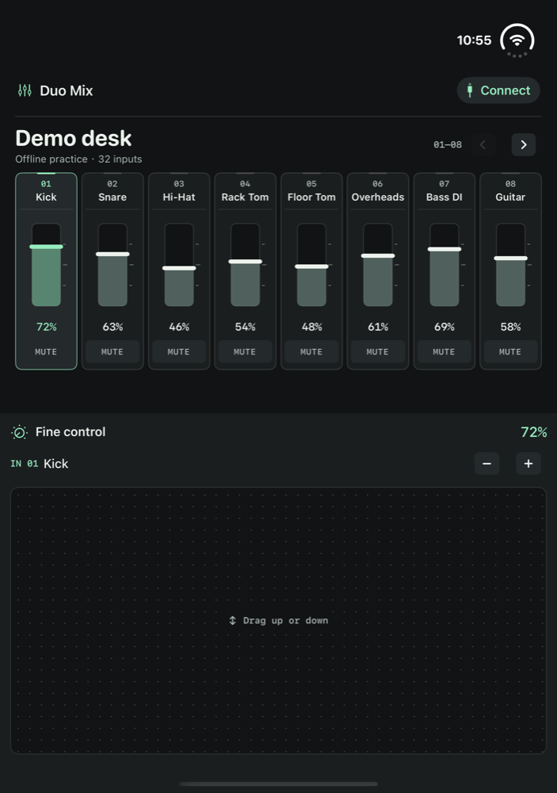

# Duo Mix

Remote control mixers on your duo.

Duo Mix is a native SwiftUI mixing surface for iPhone Duo, iPad, and iPhone. Open the app to try a 32-input practice mix. The first hardware driver targets the **PreSonus StudioLive 32SX**. It connects directly over the local network. The outstanding milestone is a two-way control test on a physical 32SX.



## Try the surface

Open `DuoMix.xcodeproj` in Xcode 27.2, choose the **DuoMix** scheme, select an iPhone Duo simulator, and press **Run**. The app also supports iOS and iPadOS 17 or later. For a physical device, choose your team in **Signing & Capabilities**.

The app opens on **Demo desk**, where all 32 inputs work offline. Tap a name to select an input. Drag its fader, tap **Mute**, or page through the bank. The fill and percentage show fader travel. On supported hardware you feel a light pickup, ticks as you move, and a firmer stop at either end. The fine pad starts from the selected fader's current position with each touch. Its **−** and **+** buttons move one percentage point.

| Surface | How to mix |
| --- | --- |
| Duo, half open on a table | Read the channel bank above the fold. Move the selected fader with the pad under your hand. |
| Duo, held like a book | Use the bank on one side of the hinge and fine control on the other. |
| Open Duo and iPad | The bank grows with the window, up to eight strips. The pad sits beside or below it as space permits. |
| Cover display and ordinary iPhone | Page through smaller banks. Selection and mute state stay with the channel as the surface resizes. |

## First test with the 32SX

1. Connect the mixer's **Control** Ethernet jack to a router's **LAN** port. Join that router's Wi-Fi on the phone. Read the mixer's control address on its **UCNET** screen. [PreSonus networking guide](https://pae-web.presonusmusic.com/downloads/products/pdf/Networking_for_StudioLive_Remote_Control_V2_EN_11102021.pdf)
2. In Duo Mix, tap **Connect** at the top. Enter the address, leave TCP port **53000** unless the desk uses a different port, and tap **Connect to mixer**. Allow Local Network access. On the console, grant the connected device **FOH** permission for the main mix. [PreSonus device permissions](https://support.presonus.com/hc/en-us/articles/360056143232-StudioLive-Series-III-Why-are-my-Meters-Dark-Grayed-out-and-can-t-Control-my-Mixer-in-Universal-Control)
3. Choose an unused input and note its starting fader and mute state. Wait for **Live**, then compare the channel name, mute state, and fader position with the desk. Move the desk fader and toggle mute. Confirm both changes appear on the phone.
4. From the app, nudge the same fader and toggle mute. Watch the physical fader and mute light, and check that the changes also come back to the app. Restore the input's original settings.
5. Drop Wi-Fi briefly, change the unused input at the desk, then restore Wi-Fi. If the automatic retries finish first, tap **Offline** and reconnect. The first values after reconnect should match the desk. Record the console firmware and which direction passed if anything differs.

The **Demo** session runs locally. **Connecting** waits for the subscription reply and initial channel state. When you move a live control, **Awaiting desk** marks the value you requested. A matching console update confirms it. If a change stays unconfirmed for two seconds after your last input, the app opens a fresh read-only sync and displays the desk's actual settings. Every new connection starts without replaying earlier commands.

## Driver design

```text
Channel strips + fine pad
           ↕
       MixerStore
           ↕
       MixerDriver
        ├── DemoDriver       in-memory practice desk
        └── PreSonusDriver   UCNET over TCP ↔ StudioLive
```

The surface consumes channel IDs, names, normalized fader travel, and mute state. The PreSonus driver translates them into console-specific messages. A second brand can implement the same driver contract. Manual connection, input faders, and input mute are the scope of this first build. Metering, mix buses, pan, EQ, scenes, and device discovery are future work.

## Research notes

- **StudioLive.** PreSonus documents the control network and Series III remote-mixing permissions. The community UCNET reference supplies TCP framing, parameter paths, and the compressed state layout. Its author reports tests on 16, 32SC, 16R, and 24R. Duo Mix decoded all 16 input channels from the author's published 16R recording at four TCP read sizes. The 32SX still needs a bench test, including whether the desk echoes this client's own writes. [PreSonus networking guide](https://pae-web.presonusmusic.com/downloads/products/pdf/Networking_for_StudioLive_Remote_Control_V2_EN_11102021.pdf) · [UCNET protocol research](https://featherbear.cc/presonus-studiolive-api/) · [Recorded 16R session](https://github.com/featherbear/presonus-studiolive-api/blob/7e9239cd64de21fab03168fc57503144061bdf6c/dumps/connect_and_idle_UC_SL16R.pcapng)
- **Fader feedback.** In a second recording, the desk answered input-fader writes with grouped positions (`MS/fdrs`). The driver matched all 100 requested positions to their recorded replies within one 16-bit step. This readback uses TCP and works independently of audio metering. [Recorded fader moves](https://github.com/featherbear/presonus-studiolive-api/blob/7e9239cd64de21fab03168fc57503144061bdf6c/dumps/line_ch1_volume%200-100.pcapng)
- **Multi-brand control.** Mixing Station uses a mixer profile and offers an offline mode. Duo Mix follows that model by keeping console messages inside a driver and exposing the same controls in demo mode. [Mixing Station manual](https://mixingstation.app/docs/getting-started/) · [Series III notes](https://mixingstation.app/docs/mixers/presonus/sl3/)
- **Duo.** Apple recommends sizing from the current window. Duo Bible's hinge-aware panes supplied the layout pattern here. The app reads SwiftUI's division region on iOS 27.1 and later. Sill's half-open trackpad informed the relative fader pad so your hand can stay below the display. [Apple Duo preparation guide](https://developer.apple.com/iphone-duo/prepare/) · [Sill](https://getsill.app/)
- **Mixing surfaces.** WING Copilot groups channel editing and metering by task. FLOW Mix brings named inputs, levels, and mute to small screens. Those references informed the channel bank and selected-channel pad. Fender lists Universal Control for iPhone and iPad and describes its StudioLive surface as iPad-optimized. [WING Copilot](https://apps.apple.com/us/app/wing-copilot/id1447618712) · [FLOW Mix](https://apps.apple.com/us/app/flow-mix/id1473097916) · [Fender Universal Control](https://apps.apple.com/us/app/fender-universal-control/id6755309706)

## Run the checks

Use **Product → Test** in Xcode with an iOS simulator selected. The suite exercises the mixer store, UCNET decoding, and a TCP loopback desk that checks both directions of control. The UI test operates the channel bank, mute switch, and precision pad. Physical fader movement, console permissions, and behavior on venue Wi-Fi require the bench test above.
